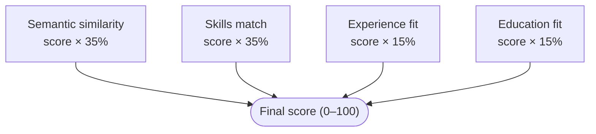
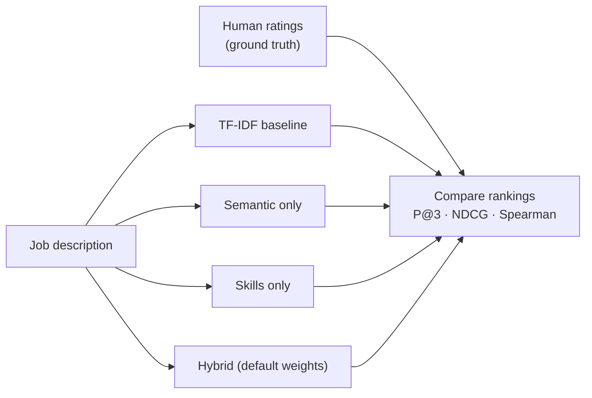

# 📄 AI Resume Screening System

> A decision-support tool that reads a **job description (JD)** and **many resumes**, extracts skills, education and experience, scores every candidate with a **hybrid NLP model**, and **ranks them with a clear explanation** for each score.

---

## 🎯 Problem statement

Companies receive hundreds of resumes for every opening. Reading and comparing them by hand is slow, repetitive and error-prone, and good candidates can be missed.

This project builds an **AI-powered resume screener** that automatically analyses resumes, compares them with a job description, calculates a **matching score** for each candidate and **ranks** them, so recruiters can quickly find the most suitable people for further evaluation.

> It is a **decision-support tool**: it helps a recruiter shortlist faster and more consistently, but the final decision always stays with a human.

---

## Working

| Requirement from the problem statement | How it is done | Where |
|---|---|---|
| Accept a JD and multiple resumes | Paste or upload a JD; upload many PDF / DOCX / TXT resumes | `app.py`, `src/parser.py` |
| Extract skills, education, experience | Skill taxonomy, degree detection, experience from date ranges | `src/extractor.py` |
| Identify skills and requirements in the JD | Splits **required** vs **preferred** skills, minimum years, minimum degree | `parse_jd()` |
| Compare using ML / NLP | TF-IDF and sentence embeddings (MiniLM) plus rule-based matching | `src/scorer.py` |
| Calculate a matching score | A 0–100 hybrid score for every candidate | `screen()` |
| Rank candidates | Ranked table, bar chart, CSV export | `app.py` |
| Help recruiters shortlist quickly | Matched / missing skills and a "why" explanation per candidate | `app.py` |
| Faster and more consistent screening | The same rules are applied to every resume | whole pipeline |


**Step by step**

1. **Read** each resume (PDF, DOCX or TXT) into plain text.
2. **Understand the JD**: find required skills, preferred ("nice to have") skills, minimum years of experience and minimum degree.
3. **Understand each resume**: find skills (from a taxonomy of 90+ skills with aliases such as `sklearn` = `scikit-learn`), total years of experience (from date ranges, overlapping jobs merged, education dates ignored) and the highest degree.
4. **Anonymise** a copy of the resume (name, email, phone, links, gendered words) before the semantic comparison, to reduce bias.
5. **Score** four things, combine them with weights, **rank**, and explain.

---

## 🧮 How the score is calculated

Every candidate gets **four mini-scores (0–100)**. They are multiplied by weights and added up.



| Part | Weight | In simple words | Formula |
|---|---|---|---|
| **Semantic** | 35% | Does the resume *talk about* the same things as the JD? | Chunked MiniLM similarity (or TF-IDF cosine), rescaled to 0–100 |
| **Skills** | 35% | How many of the wanted skills does the candidate have? | `(2 × required hit + 1 × preferred hit) / (2 × required total + 1 × preferred total)` |
| **Experience** | 15% | Does the candidate meet the required years? | `min(candidate years ÷ required years, 1)` |
| **Education** | 15% | Does the candidate meet the required degree level? | `min(candidate level ÷ required level, 1)` |

Degree levels: Diploma = 1, Bachelor's = 2, Master's = 3, PhD = 4.

> 💡 **Weights are adjustable** with sliders in the app and are normalised automatically so they always add up to 100%.

---

## 🚀 Installation and run

**Requirements:** Python 3.10 or newer.

### 1. Create a virtual environment and install
```bash
# Windows (PowerShell)
python -m venv venv
venv\Scripts\activate

# macOS / Linux
python3 -m venv venv
source venv/bin/activate

pip install -r requirements.txt
```

### 2. (Optional) enable real semantic embeddings
```bash
pip install sentence-transformers
```
This is a large download (it installs PyTorch). **The app works without it** and automatically falls back to TF-IDF; it always shows which engine was used.

### 3. Run the app
```bash
streamlit run app.py
```
Click **Load sample data** in the sidebar to try it instantly.

### 4. Run the evaluation and tests
```bash
pip install tabulate
python -m src.evaluate     # prints the comparison table
pip install pytest
python -m pytest           # unit tests (needs: pip install pytest)
```

> **Windows tip:** if you see `Access is denied` while installing, you are installing into the system Python. Use the virtual environment above.
> If plain `pytest` says `No module named 'src'`, run `python -m pytest` instead.

---

## 📊 Evaluation: baseline vs hybrid

### How the evaluation works
- `data/sample_jd.txt`: one job description.
- `data/sample_resumes/`: 8 sample (fictional) resumes with very different profiles.
- `eval/ground_truth.csv`: a **human relevance rating from 0 to 3** for each resume (0 = irrelevant, 3 = excellent).

Each method ranks the same 8 resumes, and we measure how well its ranking agrees with the human ratings.



### The four methods compared

| Method | What it does, in simple words | Strength | Weakness |
|---|---|---|---|
| **TF-IDF baseline** | Counts how many words the resume shares with the JD. Rare words count more than common ones. Plain keyword matching, with no skill list and no experience or education. | Simple and fast; the benchmark to beat | Blind to meaning and to requirements such as years or degree |
| **Semantic only** | Uses only the *similarity of meaning* part of our score (MiniLM embeddings, or TF-IDF if not installed). Skills, experience and education are switched off (weights 0). | Can match "built text classifiers" with "NLP experience" | Does not check specific required skills, so it can rank a loosely related resume too high |
| **Skills only** | Uses only the *skill matching* part. Required skills count double the preferred ones. | Directly checks what the job demands; easy to explain | Ignores experience, education and overall context |
| **Hybrid (default weights)** | **The final model.** Combines semantic 35% + skills 35% + experience 15% + education 15%. | Uses every signal, so weaknesses of one are covered by the others | Weights are hand-chosen (adjustable); need a good JD |

### The four metrics

| Metric | What it measures | Best |
|---|---|---|
| **P@3** (Precision at 3) | Of the top 3 candidates the system picked, what fraction were rated 2 or 3 by humans | 1.0 |
| **NDCG@3** | Quality of the top 3, giving more credit for placing the best candidates first | 1.0 |
| **NDCG@all** | The same idea across all 8 candidates | 1.0 |
| **Spearman** | How closely the complete ranking order matches the human order (−1 to 1) | 1.0 |

### Results

Produced with `python -m src.evaluate tfidf` (TF-IDF used for the semantic part):

| Model | P@3 | NDCG@3 | NDCG@all | Spearman |
|---|---|---|---|---|
| TF-IDF baseline | 1.00 | 1.00 | 0.991 | 0.889 |
| Semantic only | 0.667 | 0.844 | 0.975 | 0.791 |
| Skills only | 1.00 | 1.00 | 0.996 | 0.932 |
| **Hybrid (default weights)** | **1.00** | **1.00** | **1.000** | **0.964** |

**What this shows**
- The **hybrid model has the highest Spearman correlation (0.964 vs 0.889 for the baseline)**: its overall ordering is the closest to the human ordering.
- **Semantic only is the weakest** (P@3 = 0.667): it put one non-relevant candidate in the top 3. Similarity of text alone is not enough.
- **Skills only is strong** but still below the hybrid, so combining signals helps.

> ⚠️ **Honest caveat:** the sample set has only 8 resumes and the ratings were assigned by the author, so the top-3 metrics are saturated and differences are small. Spearman is the most informative column. For a stronger evaluation, rate 20+ real resumes for 2–3 different JDs. After installing `sentence-transformers`, re-run `python -m src.evaluate` (without the `tfidf` argument) and update this table.

---

## 🗂️ Project structure

```
ai-resume-screening-system/
├── app.py                  # Streamlit user interface
├── requirements.txt
├── README.md
├── data/
│   ├── sample_jd.txt       # example job description
│   └── sample_resumes/     # 8 fictional resumes
├── eval/
│   └── ground_truth.csv    # human relevance labels (0-3)
├── src/
│   ├── parser.py           # PDF / DOCX / TXT  ->  text
│   ├── skills.py           # skill taxonomy with aliases (extend this!)
│   ├── extractor.py        # skills, experience, education, JD parsing
│   ├── privacy.py          # anonymisation to reduce bias
│   ├── scorer.py           # semantic + skills + experience + education, ranking
│   └── evaluate.py         # P@k, NDCG, Spearman comparison
└── tests/
    └── test_pipeline.py    # 30 unit tests
```

---

## 🛡️ Bias mitigation

Before the semantic comparison, the resume copy has its **name line, email, phone number, links and gendered words (he/she/Mr/Mrs…) removed**. Skills, experience and education scores never use personal details at all. This is a heuristic, not a guarantee, and should be combined with human review.

---

## ⚠️ Limitations

- **Skill detection is list-based:** a skill that is not in `src/skills.py` is not scored (it is shown as an "other skill" only). Extend the list for your domain.
- **Total experience is counted, not role-relevant experience:** an 8-year Java developer still gets full experience marks for a Python job.
- **PDF quality matters:** scanned (image) or heavily designed PDFs may lose text and need OCR. The app shows the extracted text and warns when something was not detected.
- **TF-IDF fallback is lexical:** it matches words, not meaning. Install `sentence-transformers` for true semantic matching.
- **Small evaluation set** (see caveat above).
- Scores **support** a recruiter and must never replace human review.

## 🔭 Future work
- Weight experience by relevance to the role
- OCR for scanned resumes
- Learn the weights from recruiter feedback
- Cross-encoder re-ranking and larger embedding models
- Fairness audits across demographic groups
- Deploy on Streamlit Community Cloud

---

*All sample resumes are fictional. Built as a learning project in NLP and machine learning.*